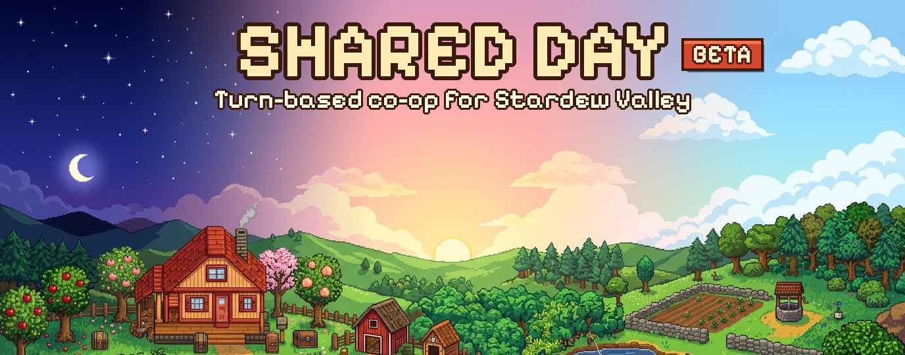
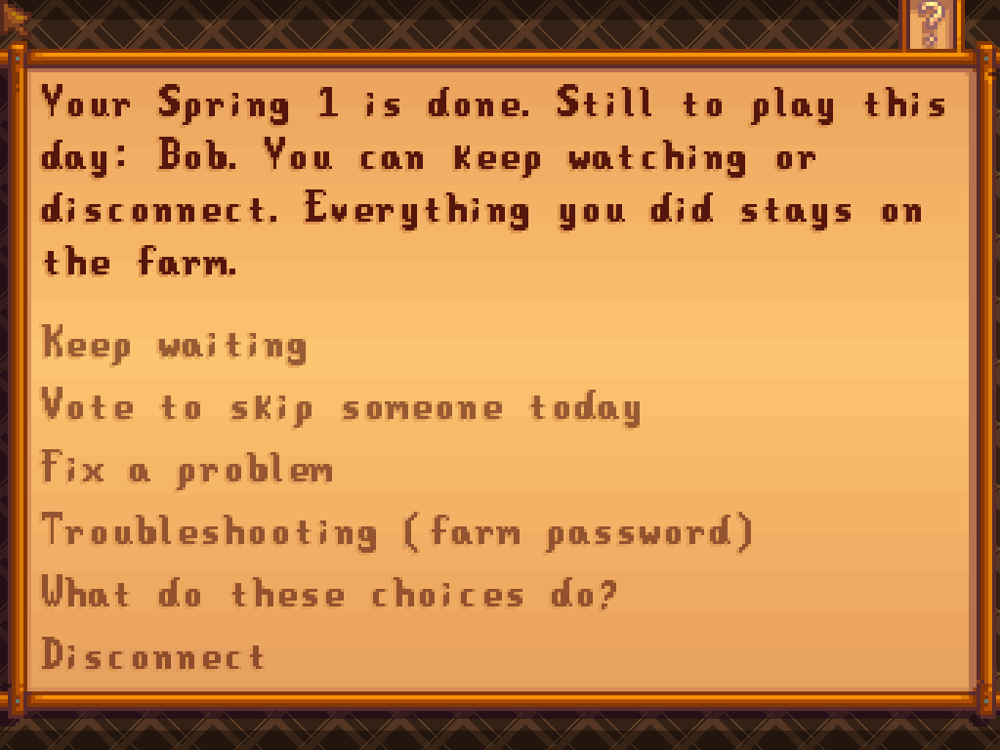
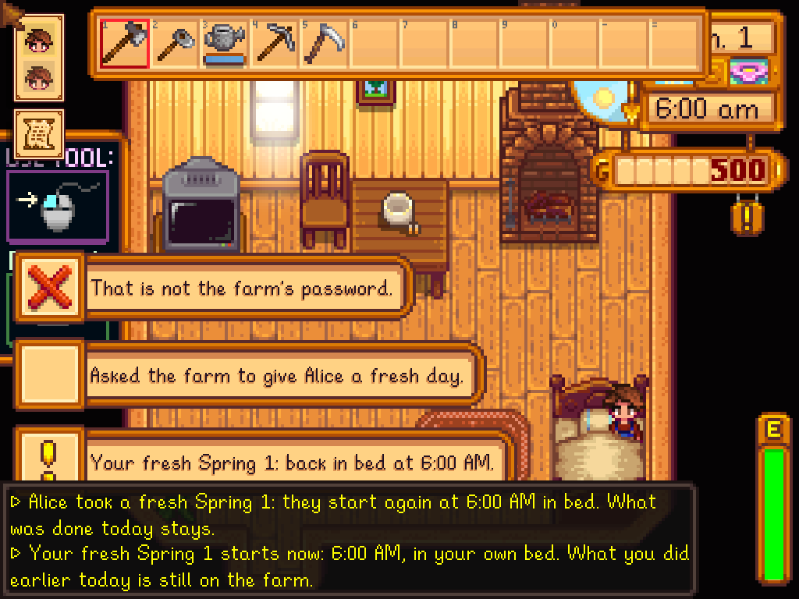
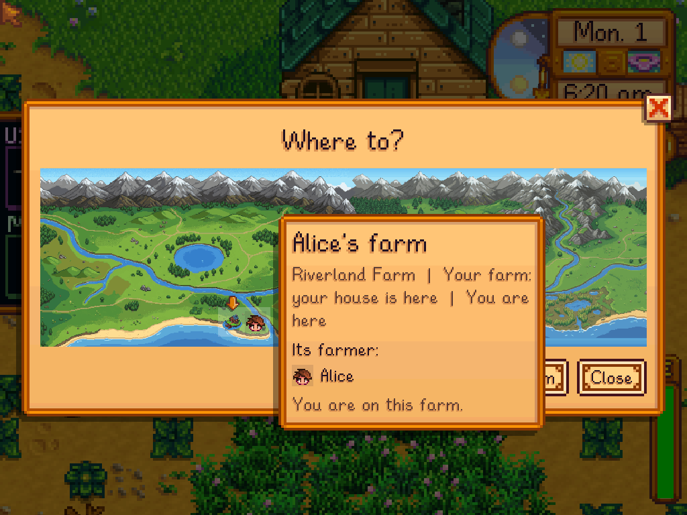
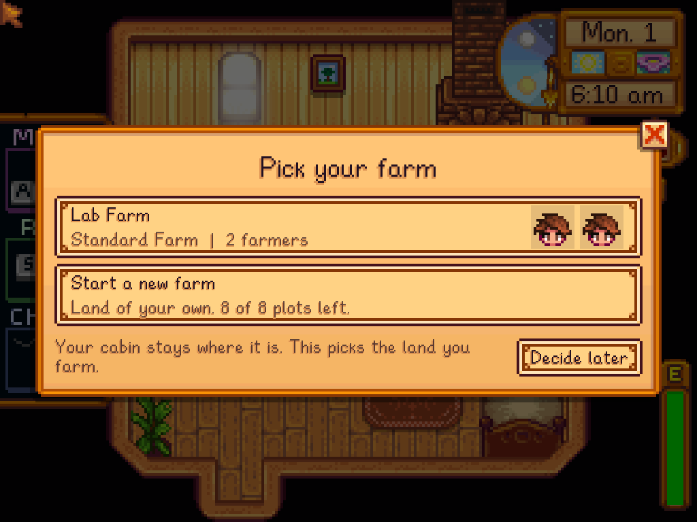

# Stardew Mods by squeetsqub

Two SMAPI mods for Stardew Valley 1.6 co-op:

| Mod | What it does | Version | Nexus |
|---|---|---|---|
| [**Shared Day**](SharedDay/README.md) | Turn-based co-op: everyone plays the same farm day, one after another, then the farm moves on together. | 0.1.35 | [Main file](https://www.nexusmods.com/stardewvalley/mods/53757) |
| [**Many Farms**](ManyFarms/README.md) | Several farms in one game: each player picks or starts a farm of their own, and a Farmstead Totem takes anyone to any of them. | 0.5.2 | [Optional file](https://www.nexusmods.com/stardewvalley/mods/53757?tab=files) |

**Download:** [nexusmods.com/stardewvalley/mods/53757](https://www.nexusmods.com/stardewvalley/mods/53757), or the zips on the [Releases](https://github.com/CarbonNode/StardewMods/releases) page (the same files).

> [!WARNING]
> **BETA.** Both mods are in active testing and we are still working out bugs. Back up your save before you use them, and start on a new or copied farm if you can. Please report problems in the Nexus Bugs tab or as a GitHub issue, with your SMAPI log.

> [!NOTE]
> **Made with AI.** These mods were built with AI assistance. The page art and Many Farms' in-game map and farmstead art are AI-generated.

## Why this exists

I built Shared Day for myself and my friends, so our co-op farm keeps going even though we are never online at the same time, and for ModRelay, the modpack and server manager I use to run our farm. Both mods work fine without ModRelay. The only parts that need it are Shared Day's launcher extras (the turn tracker, the title-screen farm hub and waking a sleeping host PC); leave those settings empty and everything else works on an ordinary SMAPI co-op farm.

| | |
|---|---|
|  |  |
|  |  |

## Repository layout

```
SharedDay/
  SharedDay.Core/    game-independent turn logic (no Stardew or SMAPI reference)
  SharedDay.Mod/     the SMAPI mod (SharedDay.dll)
  SharedDay.Tests/   xUnit tests for SharedDay.Core
  docs/              design notes: NPC replay, mid-day joins, wallets, turn-tracker contract
ManyFarms/
  ManyFarms.Core/    game-independent farm-slot logic
  ManyFarms.Mod/     the SMAPI mod (ManyFarms.dll) and its assets/
  ManyFarms.Tests/   xUnit tests for ManyFarms.Core
  art/               scripts that cut the generated farmstead art down to map size
tools/
  build-release.py   builds the release zips from built mod folders
StardewMods.sln
```

## Building

You need:

- the [.NET 6 SDK](https://dotnet.microsoft.com/download/dotnet/6.0) or newer;
- Stardew Valley 1.6 and [SMAPI](https://smapi.io/) 4.1 or later (tested on 1.6.15 with SMAPI 4.5.2), only for the two `.Mod` projects.

The `.Mod` projects use [Pathoschild.Stardew.ModBuildConfig](https://www.nuget.org/packages/Pathoschild.Stardew.ModBuildConfig) 4.4.0, which finds your game install by itself. If it can't, pass the folder that holds `Stardew Valley.dll`:

```sh
dotnet build -c Release -p:GamePath="/path/to/Stardew Valley"
```

The build writes `SharedDay/SharedDay.Mod/bin/Release/net6.0/SharedDay <version>.zip` and the same for Many Farms. Automatic deploy into your Mods folder is switched off (`EnableModDeploy=false`); copy the zip's folder into `Mods` yourself.

## Tests

The Core libraries and their tests have no game dependency, so they run anywhere:

```sh
dotnet test SharedDay/SharedDay.Tests
dotnet test ManyFarms/ManyFarms.Tests
```

## Release zips

`tools/build-release.py <mods-dir> <out-dir> --nexus-id 53757` packs `manifest.json`, the DLLs and Many Farms' `assets/` from built mod folders into `Shared Day <version>.zip` and `Many Farms <version>.zip`. It never packs `config.json`, `backups/` or logs, which on a host carry its farm password hash and join address.

## License

[MIT](LICENSE), by squeetsqub. Bug reports and pull requests are welcome.

The mods' SMAPI IDs stay `CarbonNode.SharedDay` and `CarbonNode.ManyFarms` (and their save-data keys keep that prefix): changing a UniqueID would break existing saves, update checks and the two mods' APIs. The released 0.1.35 / 0.5.2 zips still list the old author name; the next release carries `squeetsqub`.

---

Built for **[ModRelay](https://modrelay.app)**, the launcher and server manager I made to keep our modpacks and servers in sync. You don't need it for either mod; it's where they came from, and where you'll see them running every day.
